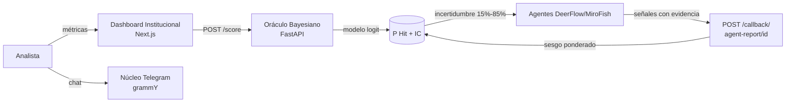

<div align="center">

# 🌌 OpenGravity

**Motor de scoring bayesiano + Monte Carlo + agentes IA para due diligence de startups.**

[English](./README.md) | Español

</div>

---

## ¿Qué es OpenGravity?

OpenGravity responde con números en lugar de intuiciones a una sola pregunta:
**¿qué probabilidad tiene esta startup de triunfar?** Alimentas el motor con las
tres señales de unit economics que más importan — LTV/CAC, runway y crecimiento —
y obtienes una **P(Hit) calibrada** mediante un modelo logístico (bayesiano)
calibrado contra 100 casos históricos de startups, con intervalos de confianza
que se estrechan si el dato viene auditado y se amplían si viene inferido por
agentes.

El motor se construyó con honestidad metodológica: backtests históricos de 30 y
100 casos (Airbnb, Stripe, Theranos, WeWork...), Brier scores, validación
leave-one-out y **limitaciones documentadas en el propio código** — ver
[Metodología](#-metodología-y-limitaciones-honestas).

Cuando el score cae en la zona de incertidumbre (15%–85%), OpenGravity no
adivina: **despacha agentes de investigación autónomos** (DeerFlow/MiroFish) que
buscan evidencia real y hacen callback con señales ponderadas que mueven el
logit directamente, con trazabilidad total del impacto de cada señal.

## ✨ Características

- 🎯 **Oráculo bayesiano** — modelo logístico con términos de interacción,
  penalización de burn y señal de runway log-normalizada
- 🤖 **Due diligence agéntica** — despacho en background de agentes con callback
  firmado por `evaluation_id`
- 📊 **Intervalos de confianza calibrados** — ±5% para datos auditados, ±15% para
  inferidos
- 🗳️ **Router multi-LLM** — bot de Telegram con failover automático (Mistral,
  Moonshot, Gemini)
- 🖥️ **Dashboard institucional** — Next.js 16 + Tailwind 4
- 🐳 **Stack Docker de un comando** — UI + Oracle + core de Telegram
- ✅ **Calibración con tests de regresión** — suite pytest que fija los umbrales
- 🔒 **Higiene de secretos** — todas las claves por variables de entorno

## 🏗️ Arquitectura



**El contrato de scoring:** los hallazgos de los agentes no empujan la
probabilidad — mueven el **logit** (acotado ±5 por señal), de modo que la
evidencia se combina de forma matemáticamente coherente y cada sesgo aplicado se
devuelve reportado (`agent_bias_applied`).

## 🚀 Inicio rápido

### Docker (recomendado)

```bash
git clone https://github.com/alicelabsllc/OpenGravity.git
cd OpenGravity
cp .env.example .env          # añade tu token de Telegram y claves
docker compose up --build
```

| Servicio | URL |
|---|---|
| Dashboard institucional | http://localhost:3000 |
| API del Oráculo | http://localhost:8000 |
| Documentación Swagger | http://localhost:8000/docs |
| Health | http://localhost:8000/health |

### Scorea tu primera startup

```bash
curl -X POST http://localhost:8000/score \
  -H "Content-Type: application/json" \
  -d '{
    "startup_name": "NeuralNet Corp",
    "metrics": { "ltv_cac": 5.5, "months_runway": 18, "moe_growth": 20 },
    "tier": "Series A",
    "sector": "B2B SaaS"
  }'
```

```json
{
  "evaluation_id": "28812b28-adcb-4aa1-b214-6fd236663683",
  "probability_hit": 0.9993,
  "confidence_interval": [0.8493, 1.0],
  "logit_score": 7.28,
  "status": "WINNER (AGENT_DISPATCHED)",
  "down_round_risk_24m": 0.1,
  "agent_bias_applied": 0.0
}
```

### Instalación manual

```bash
# Backend (Python 3.12+)
pip install -r requirements.txt
python main.py                       # Oráculo en :8000

# Dashboard (Node 20+)
cd ui && npm install && npm run dev  # UI en :3000

# Núcleo Telegram
cp .env.example .env                 # configura tokens primero
npm install && npm run dev           # bot long-polling
```

## 📡 Referencia de la API

| Método | Endpoint | Descripción |
|---|---|---|
| `POST` | `/score` | Scorea una startup. Devuelve P(Hit), IC, logit, status + `evaluation_id` |
| `POST` | `/callback/agent-report/{evaluation_id}` | Los agentes entregan señales; el score se re-evalúa |
| `GET` | `/evaluations/{evaluation_id}` | Estado completo de la evaluación |
| `GET` | `/health` | Liveness + versión + evaluaciones en memoria |

Docs interactivas en `/docs` (Swagger) y `/redoc`.

## 📖 El modelo de scoring

```
logit = prior
      + 0.70 · clamp(LTV/CAC, 0, 20)
      + 2.50 · ln(1 + crecimiento_MoM)
      + 0.50 · ln(runway / 12)
      + 3.00 · (LTV/CAC × crecimiento)   # sinergia
      − 1.50 · burn_penalty              # growth alto + LTV < 1.5
      − 1.80                             # bias calibrado
      + Σ señales_agentes                # acotadas ±5 c/u
```

| Status | Regla |
|---|---|
| `DROP` | LTV/CAC < 1.0 (kill directo) o P(Hit) < 0.25 |
| `REVIEW` | 0.25 ≤ P(Hit) ≤ 0.55 → se despachan agentes |
| `INVEST` | 0.55 < P(Hit) ≤ 0.80 |
| `WINNER` | P(Hit) > 0.80 |
| `CRITICAL *` | Sesgo agregado de agentes < −2.0 |

## 🔬 Metodología y limitaciones honestas

Publicamos nuestras limitaciones porque **un score sin calibrar es peor que
ningún score**. Del trabajo de calibración preservado en
[`archive/`](./archive/README.md):

- **N=100 casos históricos** — el IC 95% de cualquier calibración con este
  tamaño es de ±15% aprox. Lo decimos en lugar de ocultarlo.
- **El crecimiento MoM es un proxy sintético** — reconstruido de fuentes
  públicas (S-1, prensa), no métricas internas. Camino a la solución:
  SimilarWeb/data.ai.
- **Aún no hay señal de fundador/equipo** — el modelo no ve al equipo
  (roadmap V11).
- **Fraude ≠ error de modelo** — casos como Theranos se muestran pero se
  *excluyen* del cálculo. Un dataset fraudulento nunca debe ajustar los priors.
- **LOOCV, no train-on-test** — las estimaciones out-of-sample usan
  leave-one-out cross-validation; Brier scores reportados en `archive/data/`.
- **Sin partición temporal todavía** — objetivo V11: dataset de 200+ casos con
  splits temporales.

> ⚠️ **Aviso.** OpenGravity es una herramienta de apoyo a decisiones. **No** es
> asesoramiento financiero, legal ni de inversión. Las probabilidades son
> salidas de un modelo, no garantías.

## 🤝 Licencia y contribuciones

OpenGravity es *source-available* bajo la [Licencia Propietaria AliceLabs](./LICENSE):
puedes leerlo, ejecutarlo y estudiarlo con fines no comerciales. Las
contribuciones (bug fixes, docs, datos de calibración) son bienvenidas — ver
[CONTRIBUTING.md](./CONTRIBUTING.md). Licencias comerciales:
[github.com/alicelabsllc](https://github.com/alicelabsllc).

## ⭐ Apoya el proyecto

Si OpenGravity te ahorra una hora de due diligence, deja una ⭐ — ayuda de
verdad a que el proyecto llegue a más builders.

<div align="center">
<sub>Construido con 🌌 por <b>AliceLabs</b> — © 2026. Todos los derechos reservados.</sub>
</div>
