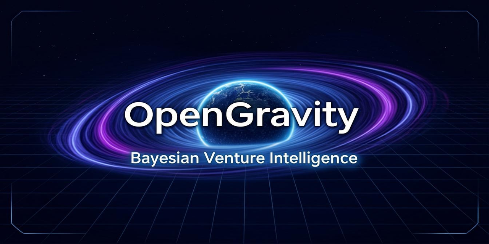
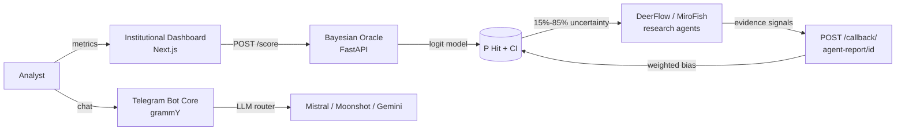

<div align="center">



# 🌌 OpenGravity

**A Bayesian + Monte Carlo + Agentic AI scoring engine for startup due diligence.**

Turn unit economics into a calibrated probability of success — then let autonomous
agents challenge the number with real-world evidence.

[](./LICENSE)
[](./CHANGELOG.md)
[](./requirements.txt)
[](./package.json)
[](https://fastapi.tiangolo.com)
[](./ui)
[](./tests)
[](https://eddyflores100-lang.github.io/OpenGravity/)

**🌐 Try it live — no install, no keys:** **[eddyflores100-lang.github.io/OpenGravity](https://eddyflores100-lang.github.io/OpenGravity/)**
Type a startup name and the agent squad crawls Wikipedia, Wikidata, GitHub,
Hacker News and DuckDuckGo in your browser, then feeds the Bayesian engine.
Full source of the demo: [`demo/`](./demo).

</div>

---

## What is OpenGravity?

OpenGravity answers one question with numbers instead of vibes: **how likely is
this startup to succeed?** Feed it the three unit-economics signals that matter
most — LTV/CAC, runway, and growth — and it returns a calibrated **P(Hit)**
derived from a logistic (Bayesian) model calibrated against 100 historical
startup outcomes, with confidence intervals that widen or narrow depending on
whether the data is audited or agent-inferred.

The engine was built the honest way. Before writing a single line of V10, the
team ran **30-case and 100-case historical backtests** (Airbnb, Stripe, Theranos,
WeWork...), measured Brier scores, applied leave-one-out cross-validation, and
documented every limitation of the dataset in the source code. That
methodological honesty is a feature, not an accident — see
[Methodology](#-methodology--honest-limitations).

When a score lands in the uncertainty zone (15%–85%), OpenGravity doesn't guess.
It **dispatches autonomous research agents** (DeerFlow/MiroFish) that scrape
real-world evidence and call back with weighted signals — findings move the
logit directly, with full auditability of how much each signal changed the score.

## ✨ Features

- 🎯 **Bayesian Oracle** — logistic scoring engine with interaction terms, burn
  penalty, and log-normalized runway signal
- 🤖 **Agentic due diligence** — background dispatch of research agents that
  update scores via a signed callback contract (`evaluation_id`)
- 📊 **Calibrated confidence intervals** — ±5% for audited data, ±15% for
  inferred data
- 🗳️ **Multi-provider LLM router** — Telegram bot with automatic failover
  across Mistral, Moonshot, and Gemini
- 🖥️ **Institutional Dashboard** — Next.js 16 + Tailwind 4 mission-control UI
- 🐳 **One-command Docker stack** — UI + Oracle + Telegram core
- ✅ **Regression-tested calibration** — pytest suite locks the decision
  thresholds
- 🔒 **Secrets hygiene** — all keys via environment variables, `.env.example`
  included

## 🏗️ Architecture



**The scoring contract:** agent findings don't nudge the probability — they
move the **logit** (bounded ±5 per signal), so evidence combines in a
mathematically coherent way, and every bias applied is reported back
(`agent_bias_applied`).

## 🚀 Quickstart

### Docker (recommended)

```bash
git clone https://github.com/eddyflores100-lang/OpenGravity.git
cd OpenGravity
cp .env.example .env          # add your Telegram token & keys
docker compose up --build
```

| Service | URL |
|---|---|
| Institutional Dashboard | http://localhost:3000 |
| Oracle API | http://localhost:8000 |
| Swagger docs | http://localhost:8000/docs |
| Health | http://localhost:8000/health |

### Score your first startup

```bash
curl -X POST http://localhost:8000/score \
  -H "Content-Type: application/json" \
  -d '{
    "startup_name": "NeuralNet Corp",
    "metrics": { "ltv_cac": 5.5, "months_runway": 18, "moe_growth": 20 },
    "tier": "Series A",
    "sector": "B2B SaaS"
  }'
```

```json
{
  "evaluation_id": "28812b28-adcb-4aa1-b214-6fd236663683",
  "probability_hit": 0.9993,
  "confidence_interval": [0.8493, 1.0],
  "logit_score": 7.28,
  "status": "WINNER (AGENT_DISPATCHED)",
  "down_round_risk_24m": 0.1,
  "agent_bias_applied": 0.0
}
```

### Manual setup

```bash
# Backend (Python 3.12+)
pip install -r requirements.txt
python main.py                       # Oracle on :8000

# Dashboard (Node 20+)
cd ui && npm install && npm run dev  # UI on :3000

# Telegram core
cp .env.example .env                 # configure tokens first
npm install && npm run dev           # long-polling bot
```

## 📡 API Reference

| Method | Endpoint | Description |
|---|---|---|
| `POST` | `/score` | Score a startup. Returns P(Hit), CI, logit, status + `evaluation_id` |
| `POST` | `/callback/agent-report/{evaluation_id}` | Agents deliver evidence signals; score is re-evaluated |
| `GET` | `/evaluations/{evaluation_id}` | Full evaluation state (initial + agent updates) |
| `GET` | `/health` | Liveness + version + in-memory evaluation count |

Interactive docs at `/docs` (Swagger UI) and `/redoc`.

## 📖 The Scoring Model

The engine computes a logit from three clamped economic signals:

```
logit = prior
      + 0.70 · clamp(LTV/CAC, 0, 20)
      + 2.50 · ln(1 + MoE_growth)
      + 0.50 · ln(runway / 12)
      + 3.00 · (LTV/CAC × growth)      # synergy term
      − 1.50 · burn_penalty            # high growth + LTV < 1.5
      − 1.80                           # calibrated bias
      + Σ agent_signals                # bounded ±5 each
```

| Status | Rule |
|---|---|
| `DROP` | LTV/CAC < 1.0 (hard kill) or P(Hit) < 0.25 |
| `REVIEW` | 0.25 ≤ P(Hit) ≤ 0.55 → agents dispatched |
| `INVEST` | 0.55 < P(Hit) ≤ 0.80 |
| `WINNER` | P(Hit) > 0.80 |
| `CRITICAL *` | Aggregate agent bias < −2.0 |

## 🔬 Methodology & Honest Limitations

We publish our limitations because **an uncalibrated score is worse than no
score**. From the calibration work preserved in [`archive/`](./archive/README.md):

- **N=100 historical cases** — the 95% CI on any calibration at this size is
  roughly ±15%. We say so instead of hiding it.
- **Month-over-month growth is a synthetic proxy** — reconstructed from public
  sources (S-1 filings, press coverage), not internal metrics. Path to fix:
  SimilarWeb/data.ai integration.
- **No founder/team signal yet** — the model cannot see the team. Requires
  structured LinkedIn-style data (V11 roadmap).
- **Fraud ≠ model error** — cases like Theranos are displayed but *excluded*
  from scoring metrics. A fraudulent dataset should never tune the priors.
- **LOOCV, not train-on-test** — out-of-sample estimates use leave-one-out
  cross-validation; reported Brier scores in `archive/data/`.
- **No temporal split yet** — cases span different eras; a 200+ case dataset
  with time-aware splits is the V11 target.

> ⚠️ **Disclaimer.** OpenGravity is a decision-support research tool. It is
> **not** investment, legal or financial advice. Probabilities are model
> outputs, not guarantees.

## 🗂️ Project Structure

```
OpenGravity/
├── main.py                # FastAPI Oracle (scoring + agent callbacks)
├── scoring.py             # Bayesian engine (stable sigmoid, thresholds)
├── models.py              # Pydantic v2 contracts (request/report/result)
├── requirements.txt
├── src/                   # Telegram bot core (TypeScript)
│   ├── index.ts           #   grammY bot, auth, long-reply splitting
│   ├── llm/llm.ts         #   multi-provider LLM router (fetch, failover)
│   ├── lib/storage.ts     #   JSON storage w/ real query engine
│   └── tools/             #   function-calling tool definitions
├── ui/                    # Institutional Dashboard (Next.js 16 + TW4)
├── tests/                 # Engine regression suite (pytest)
├── docs/                  # Strategy & playbooks
├── archive/               # V9.x calibration trail (frozen) — see README inside
├── Dockerfile             #   core (Node)
├── Dockerfile.oracle      #   oracle (Python)
└── docker-compose.yml     # ui + oracle + core, one command
```

## 🗺️ Roadmap

- [ ] **V10.6** — persistent evaluation store (Redis/Postgres) + API keys for
      hosted endpoint
- [ ] **V11** — sector-specific priors + founder/team signal
- [ ] **V11** — 200+ case dataset with temporal train/test splits
- [ ] **V11** — Monte Carlo scenario layer in the dashboard (already in
      `archive/scripts`, needs UI)
- [ ] **V12** — LP portfolio mode: score whole portfolios, not just startups

## 🤝 Contributing

OpenGravity is source-available under the
[AliceLabs Proprietary License](./LICENSE): you can read, run and study it for
non-commercial purposes. Contributions (bug fixes, docs, calibration data) are
welcome — see [CONTRIBUTING.md](./CONTRIBUTING.md). Commercial licenses:
contact via [github.com/eddyflores100-lang](https://github.com/eddyflores100-lang).

## ⭐ Support the project

If OpenGravity saves you an hour of diligence, or you just like seeing
calibrated probabilities instead of vibes, consider leaving a ⭐ — it genuinely
helps the project reach more builders.

<div align="center">
<sub>Built with 🌌 by <b>AliceLabs</b> — © 2026. All rights reserved.</sub>
</div>
